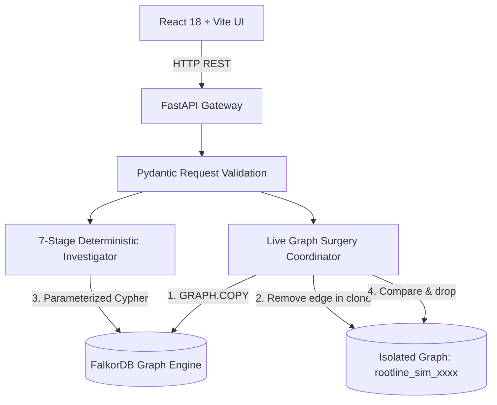

# ROOTLINE OMNI

**Graph-Native Incident Investigation & Counterfactual Dependency Analysis, powered by FalkorDB.**

ROOTLINE investigates complex distributed service incidents by traversing dependency topologies, weighing multi-modal evidence (metrics, logs, deployment times, canary rollbacks), consulting historical resolutions, calculating blast radius, and recording human operator decisions. 

Its standout differentiator is **Live Graph Surgery**: an operator can test a dependency-edge counterfactual in an isolated FalkorDB graph copy (`GRAPH.COPY`), rerun the exact same deterministic investigation engine, observe causal rerouting or dropped candidates, and mathematically verify that baseline dependency topology was preserved without side effects.

---

## Hackathon Track Alignments (Graph Hacks 2026)

- **Primary Track — Track 01: Agents That Act on Connected Data**  
  *Core differentiator*: Live Graph Surgery conducts safe, isolated counterfactual graph interventions using FalkorDB's native `GRAPH.COPY` and parameterized Cypher edge mutations, verifying causal impact versus negative controls.
- **Supporting Capability — Track 02: Investigation Memory**  
  Operator decisions (approvals/rejections with compliance rationale) persist in FalkorDB and dynamically inform subsequent investigations across shared candidate services.
- **Supporting Capability — Track 03: Company Brain**  
  Service ownership teams (`OWNS`), step-by-step operator runbooks (`APPLIES_TO`), and architecture decision records (`GOVERNS`) are traversed directly through FalkorDB graph relationships.

> **Operational Safety Disclaimer:** All incident, telemetry, runbook, and ADR records in ROOTLINE are **entirely synthetic**. ROOTLINE does not connect to live production telemetry, does not execute automated production remediation, and requires human operator approval for all recommendations.

---

## Why FalkorDB is Essential

FalkorDB is the core reasoning substrate of the product, not merely a storage layer:
1. **Multi-Hop Traversal**: Candidate root causes are discovered by traversing variable-length directed paths (`[:DEPENDS_ON*1..4]`) from the affected service.
2. **Reverse Blast Radius**: Upstream impacted services are computed by traversing incoming dependency paths in reverse.
3. **Multi-Modal Evidence Graph**: Deployments (`CHANGED`), historical resolutions (`CAUSED_BY`), and telemetry evidence (`HAS_EVIDENCE`, `ABOUT`) are unified in a single connected graph.
4. **Live Graph Surgery (`GRAPH.COPY`)**: Creates an isolated, ephemeral graph copy in milliseconds, enabling non-destructive topology mutation and counterfactual reruns.

---

## Full-Stack Architecture



Key code files:
- `backend/main.py`: FastAPI HTTP controllers, Pydantic schemas, and error handlers
- `backend/graph.py`: FalkorDB connection handling and ContextVar query routing
- `backend/queries.py`: Parameterized Cypher data access layer
- `backend/investigator.py`: 7-stage deterministic ranking engine and score breakdowns
- `backend/surgery.py`: Live Graph Surgery orchestration, invariance verification, and cleanup
- `backend/seed.py`: Idempotent synthetic graph generator (15 services, 7 incidents, 10 evidence records)
- `frontend/src/App.jsx`: Interactive operational workbench, SVG causal path visualizer, and Company Brain explorer
- `frontend/src/styles.css`: High-contrast, WCAG-compliant dark theme design system

---

## Local Setup & Quickstart (Windows PowerShell)

### Prerequisites
- Python 3.10+ (tested on Python 3.12.10)
- Node.js 18+ (tested on Node.js v25.5.0, npm 11.8.0)
- Docker Desktop with Linux WSL2 engine

### 1. Start FalkorDB Container
In PowerShell:
```powershell
docker run -d --name rootline-falkordb -p 6379:6379 -p 3000:3000 falkordb/falkordb:latest
```
*(If the container already exists, run `docker start rootline-falkordb`)*

### 2. Configure Backend & Seed Database
From the repository root (`rootline/`):
```powershell
python -m venv .venv
.\.venv\Scripts\Activate.ps1
pip install -r requirements-dev.txt
Copy-Item .env.example .env
python -m backend.seed
```
Expected output:
```
seeded: {'services': 15, 'incidents': 7, 'evidence': 10}
```

### 3. Run the Automated Test Suite (44 Tests)
```powershell
pytest -q
```
Expected output:
```
............................................                             [100%]
44 passed in 11.83s
```

### 4. Build & Start the Application
Option A — Production Mode (FastAPI serves compiled frontend):
```powershell
cd frontend
npm install
npm run build
cd ..
uvicorn backend.main:app --port 8000
```
Open **`http://localhost:8000`** in your browser.

Option B — Development Mode (Vite Hot-Reload):
```powershell
# Terminal 1 (Backend):
uvicorn backend.main:app --reload --port 8000

# Terminal 2 (Frontend):
cd frontend
npm run dev
```
Open **`http://localhost:5173`** in your browser.

---

## 3-Minute Judge Demonstration Walkthrough

1. **Select Incident**: Select **`INC-2026-101`** (SEV1: Checkout returning HTTP 500s) and click **"Run investigation"**.
2. **Review Candidate Causes**:
   - `#1 Redis Cache (cache-redis)` ranks highest (Score: 7.00) based on graph proximity, a recent memory configuration deployment (`DEP-501`), and high-eviction telemetry evidence (`EV-101-2`).
   - `#2 Payment Service (payment-service)` is penalized by -2.5 due to contradicting evidence (`EV-101-5`: a canary rollback did not reduce error rates).
3. **Execute Live Graph Surgery**:
   - In the Live Graph Surgery panel, click the preset **`🎯 Key Cut: inventory → cache`** (or select `inventory-service → cache-redis`).
   - Click **"Cut edge and compare"**.
   - **Observe Result**: The vector SVG visualizer shows the baseline causal path rerouting through `payment-service`.
   - **Verify Safety Grid**:
     - Baseline Topology: **`UNCHANGED`**
     - Baseline Result: **`UNCHANGED`**
     - Temporary Graph: **`CLEANED`**
     - Audit Record: **`SAVED`**
4. **Test Negative Control**:
   - Click preset **`🛡️ Negative Control: search → index`** (`search-service → search-index`).
   - Click **"Cut edge and compare"**.
   - Notice that the system reports **"Investigation unchanged"** with 0 candidate deltas, proving ROOTLINE does not manufacture false positives.
5. **Record Operator Decision**:
   - Under Proposed Action, enter operator rationale: `Reverting DEP-501 per past resolution INC-2026-044`.
   - Click **"Approve Recommendation"**. The decision is permanently stored in FalkorDB.
6. **Inspect Company Brain**:
   - Click the **"🧠 Company Brain"** tab to inspect operator runbooks (`RB-cache-evictions`), architecture decisions (`ADR-007`), and team ownership mapped directly from FalkorDB.

---

## API Specification

| Endpoint | Method | Description |
|---|---|---|
| `/api/health` | `GET` | Health check probing FalkorDB connection and seed status |
| `/api/incidents` | `GET` | Returns list of open and historical incidents |
| `/api/graph/overview` | `GET` | Node label counts, dependency edges, open severity stats |
| `/api/company-brain` | `GET` | Aggregated runbooks, ADRs, and team ownership directory |
| `/api/investigate/{id}` | `POST` | Executes 7-stage deterministic graph investigation |
| `/api/investigations` | `GET` | Lists persisted historical investigations and decisions |
| `/api/investigations/{id}` | `GET` | Retrieves specific investigation report and decision record |
| `/api/investigations/{id}/decision` | `POST` | Records human operator decision (approved/rejected with rationale) |
| `/api/graph/edges` | `GET` | Returns available dependency edges for surgery |
| `/api/simulate` | `POST` | Executes Live Graph Surgery in an isolated temporary graph |

---

## Truthful Disclosures & Limitations

1. **Synthetic Data**: All services, incidents, deployments, evidence, and runbooks are fictional demonstration assets.
2. **Heuristic Scores**: Scores are explainable deterministic heuristic weights, **not statistical probabilities**.
3. **No Automated Remediation**: ROOTLINE never executes destructive OS or shell commands. Recommendations require human operator approval.
4. **Workflow Orchestration**: The sequential trace represents deterministic backend execution stages, not an autonomous generative multi-agent system.
5. **Graph Surgery Scope**: Graph surgery supports dependency edge counterfactuals (`DEPENDS_ON`). It requires FalkorDB `GRAPH.COPY` support.
6. **Audit Invariance**: An immutable audit node is appended to the baseline graph; "baseline unchanged" refers to dependency topology invariance, not byte-for-byte file immutability.

---

## AI Assistance Disclosure

- **AI Tools Used**: Google DeepMind Antigravity agentic coding assistant was utilized in the IDE for workspace inspection, code refactoring, constructing parameterized Cypher queries, authoring React components, generating automated Pytest suites, running PowerShell commands, and drafting documentation.
- **Human Engineering & Verification**: Architectural direction, graph schema design, heuristic score weighting formulas, Live Graph Surgery invariant specifications, and verification of all 44 automated tests were reviewed and executed by the engineer.

---

## Submission Links

- **Repository**: _[Insert your public GitHub repository URL]_
- **Demo Video**: _[Insert your 2:45 demo video URL]_
- **Hackathon Track**: Graph Hacks 2026 — Track 01 (Agents That Act on Connected Data)
